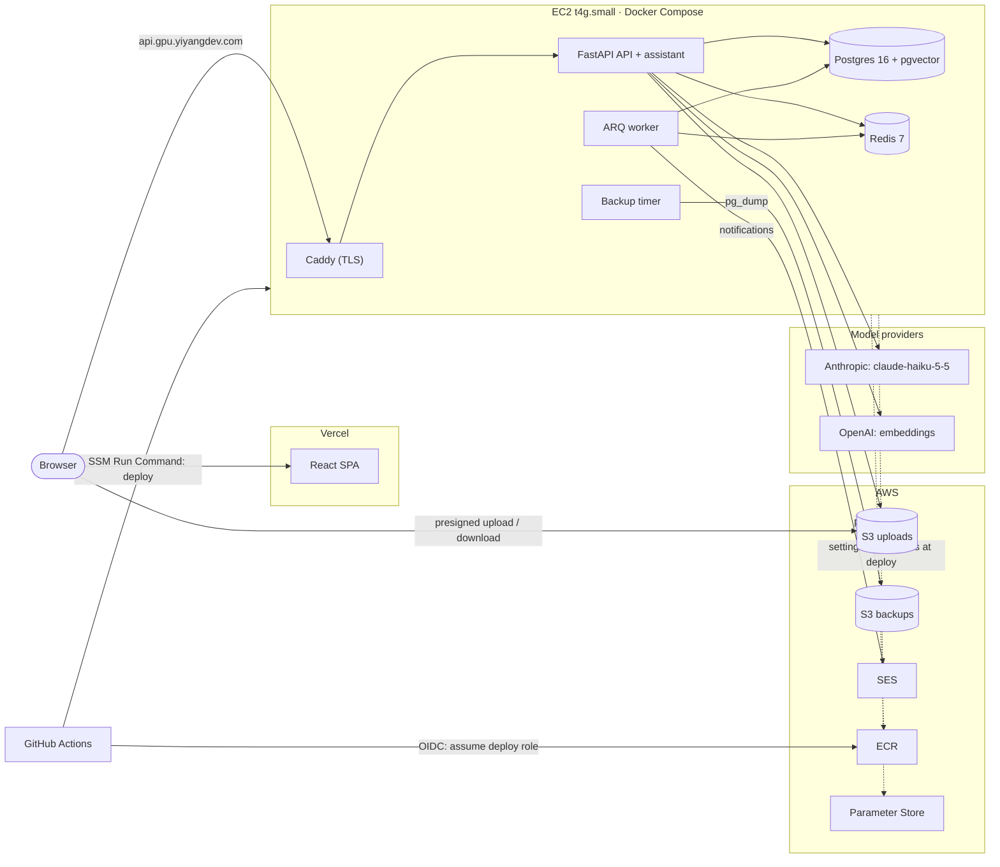

# GPU Reserve

[](https://github.com/yyang43967/gpu-reserve/actions/workflows/ci.yml)

Booking for shared GPU servers in university labs: students reserve GPUs within fair-use quotas, admins approve requests for restricted machines, and an AI assistant answers policy questions and books hardware, but only after the user confirms.

**Live demo: [gpu.yiyangdev.com](https://gpu.yiyangdev.com).** The sign-in page has a one-click demo student login. Demo data is replayed around the current date every night.

<!-- Demo GIF: docs/media/demo.gif -->

## Highlights

- **Double booking is impossible at the database level.** A Postgres exclusion constraint on (GPU, time range) is the authority. The load test found that concurrent bookings could deadlock on it; bookings on a server are now serialized with a row lock. Since the fix, every timed race of 100 students for 4 possible bookings (6 on a laptop, 15 on a twin of the production instance) ended with exactly 4 bookings, 96 refusals, and no overlapping allocation. [Load-test results](loadtest/results.md#booking-race)
- **The assistant never writes without confirmation.** Every booking or cancellation stops at a confirmation card, and the database makes the confirmed write happen exactly once. Over a 63-case evaluation, including prompt injection and requests for other users' data, there were 0 safety failures in all 8 runs. [Agent evaluation](evals/agent/results/2026-11-10.md)
- **The production model was chosen by evaluation.** claude-haiku-5-5 passed 58/63 cases in both runs, against 50/63 for gpt-5.4-mini and 48/63 for a self-hosted Qwen3.6-35B-A3B on vLLM, at about a quarter of gpt-5.4-mini's cost per run. The lead over gpt-5.4-mini is significant but marginal (Holm-corrected p = 0.043). [Decision](docs/decisions.md#production-model-chosen-from-the-eval)
- **The availability cache cuts database load, not latency.** At a fixed rate it lowered Postgres CPU by 73% for availability on the laptop and 75% on the production twin. Throughput is bound by the API's CPU, so slot-search capacity showed no consistent difference. [Load-test results](loadtest/results.md#summary)
- **Production on one small instance, estimated at about $18.60 a month.** Terraform, deploys from CI through GitHub OIDC with no stored AWS keys, daily backups with a restore check against production, and an enforced Content Security Policy. [Cost estimate](docs/decisions.md#cost)

## Architecture



Evaluations and local development also use Langfuse for tracing and Modal for serving Qwen3.6 on vLLM. Production has no tracing configured. More detail, including request sequences and the lock order, is in [docs/architecture.md](docs/architecture.md).

**Stack:** FastAPI, SQLAlchemy (async), Alembic, ARQ, LangGraph · React 19, TypeScript, TanStack Query, React Hook Form + Zod, Tailwind, shadcn/ui · Postgres 16 with `btree_gist` and `pgvector`, Redis 7 · Terraform, Docker Compose, Caddy, GitHub Actions · k6, Playwright, pytest with testcontainers.

## Key design decisions

Each decision, with the options considered and the evidence, is in [docs/decisions.md](docs/decisions.md).

- **Exclusion constraint, then a deadlock fix.** Allocation picks the lowest free GPUs and retries in a savepoint if the constraint fires. Alternatives were serializable isolation, row locks on GPUs, and a per-server lock. The load test showed that two inserts of the same GPU at the same moment can deadlock on the constraint's check, so bookings on one server now take a row lock, and the constraint stays as the backstop. Quota is enforced under a per-user advisory lock. [GPU allocation](docs/decisions.md#gpu-allocation-and-double-booking-prevention), [quota](docs/decisions.md#quota-enforcement-under-concurrency)
- **Availability cache with generation counters.** Availability is cached in Redis per server and day under a per-server generation number. A committed write increments the generation instead of deleting keys, so a reader can never store stale data under the new generation. [Caching and invalidation](docs/decisions.md#availability-caching-and-invalidation)
- **Interrupt before every write.** Write tools run the real booking service as a dry run in a rolled-back transaction, then stop the LangGraph run at an interrupt and show the result as a card. On confirmation the tool runs again from the top against current data, and writes only if the result still matches what the user saw. A row unique on the tool call makes the write happen once, even if the process crashes between the commit and the checkpoint. Tools take the user from the server, never from the model. [Confirmation](docs/decisions.md#writes-happen-only-after-confirmation), [exactly once](docs/decisions.md#exactly-once-enforced-by-the-database)
- **OIDC deploys with an ID-based subject.** CI assumes a role that can push one image repository and run commands on one instance. The trust policy matches GitHub's immutable subject, which includes the owner's and repository's numeric IDs, so a recreated account or repository with the same name cannot assume it. Only `main` may use the `production` environment. [Terraform and the deploy role](docs/decisions.md#main-terraform-configuration), [CI/CD](docs/decisions.md#cicd)
- **Backups with restore verification.** A daily `pg_dump` to S3, plus one before every migration. `release.sh verify-backup` restores the newest dump into a throwaway container on the instance and compares the migration version, extensions, constraint, and every table's row count with production, without touching it. [Backups](docs/decisions.md#backups)
- **Demo data kept current.** Every night the seeded reservations are deleted and the same plan is booked again around the current date through the normal booking service. Real bookings win: a plan entry that conflicts is skipped, and rows that aren't seeded are never touched. [Demo data](docs/decisions.md#demo-data-kept-current)

## Results

### Assistant evaluation

63 cases (bookings, rule violations, conflicts, cancellations, clarifying questions, slot search, policy and hardware questions, out-of-scope requests, other users' data, prompt injection, changes of mind), two runs per configuration from one frozen commit. A case passes only if it passed both runs. Full report: [evals/agent/results/2026-11-10.md](evals/agent/results/2026-11-10.md).

| Configuration | Strict | Runs 1, 2 | Wrong cards | Turn p50 / p95 | Cost per run |
|---|---|---|---|---|---|
| **claude-haiku-5-5**, effort low (production) | **58/63 (92%)** | 59, 61 | 0, 0 | 2.7 / 8.1 s | $0.05–0.07 |
| gpt-5.4-mini, effort low | 50/63 (79%) | 55, 54 | 0, 2 | 2.9 / 7.4 s | $0.24–0.25 |
| Qwen3.6-35B-A3B, thinking on (vLLM, L40S) | 48/63 (76%) | 54, 53 | 1, 0 | 9.4 / 36.0 s | $0.16–0.18 GPU |
| Qwen3.6-35B-A3B, thinking off (vLLM, L40S) | 23/63 (37%) | 33, 28 | 1, 5 | 3.0 / 10.0 s | $0.06 GPU |

- **Pairwise** (exact McNemar on strict outcomes, Holm-corrected over 6 pairs): Haiku beats gpt-5.4-mini (9 vs 1 disagreeing cases, p = 0.043) and Qwen with thinking on (12 vs 2, p = 0.039). Qwen with thinking off is worse than every other configuration (p < 0.001). Qwen with thinking on and gpt-5.4-mini show no significant difference.
- **Limits:** with 63 cases the Haiku result sits just under the threshold. The checkers were revised after reading the hosted models' pilot answers. Hand labels cover hosted answers only. The full report lists these and the rest.

### Retrieval

The assistant's policy search is evaluated on 30 labeled questions against a 90% hit-rate requirement. The reported result is the first run: **22/30 (73%)**, below the requirement. A minimum-score threshold chosen on the dev set was then found to cut in-scope results without separating out-of-scope ones. With it removed, the same set gives 27/30. That second number is a regression gate in CI, not a held-out result, because the change followed the failed run. [Retrieval results](evals/rag/results.md)

### Load tests

k6 against a laptop stack with CPU limits that add up to a t4g.small, then against a twin of the production instance on AWS (through production's Caddy and Compose file), three repeats per configuration, medians. Full report: [loadtest/results.md](loadtest/results.md).

| Availability cache off → on | Laptop | Production twin |
|---|---|---|
| Postgres CPU, availability at a fixed rate | 29% → 8% (−73%) | 22% → 5% (−75%) |
| Postgres CPU, slot search at a fixed rate | 6% → 3% (−39%) | 6% → 3% (−47%) |
| Availability p95 at that rate | 210 → 160 ms (ranges overlap) | 23 → 15 ms |
| Slot search p95 at that rate | 123 → 120 ms (unchanged) | 320 → 231 ms |
| Slot-search capacity | no consistent difference | sustained 12 req/s either way; best successful step 15 → 17 |

- **The bottleneck is the API process's CPU.** On the twin, one uvicorn process sat at a full vCPU while Postgres used 6–33% of one. The cache's value shows when the API scales out; that is an extrapolation, since these runs used one process.
- **Findings fixed:** the booking deadlock, a probable keep-alive race between Caddy and uvicorn (13 errors under overload, none once Caddy's idle timeout was set below uvicorn's), and a worker health check that needed a full CPU. **Recorded, not changed:** past saturation, throughput drops as requests wait out the 3 s connection-pool timeout.

## Local setup

Requirements: Docker with Compose v2, [uv](https://docs.astral.sh/uv/), Node 24, and pnpm.

```bash
cp .env.example .env
docker compose --profile core up -d --wait       # postgres, redis, api on :8000
cd backend && uv sync && uv run alembic upgrade head
ADMIN_PASSWORD=... SEED_STUDENT_PASSWORD=... uv run python -m app.seed
cd ../frontend && pnpm install && pnpm dev       # http://localhost:5173
```

The `full` profile adds the worker, Mailpit, and S3-compatible storage. The assistant needs `OPENAI_API_KEY` for policy search and a key for the model in `ASSISTANT_MODEL`. Hot reload, uploads, migrations against Compose, and the evaluation commands are in [docs/development.md](docs/development.md).

## Tests

```bash
cd backend && uv run ruff check . && uv run mypy app && uv run pytest    # unit and integration (testcontainers)
cd frontend && pnpm lint && pnpm test
```

End-to-end tests (Playwright against its own Compose project) and load tests are described in [docs/development.md](docs/development.md#tests-and-checks). CI runs the backend, frontend, Terraform, and deploy-script checks on every pull request. On `main` it also builds the arm64 image, smoke-tests the stack, and runs the end-to-end tests.

## Deployment

Infrastructure is Terraform in `us-east-2` ([infra/terraform](infra/terraform/README.md)). After CI passes on `main`, the deploy workflow builds the arm64 image, pushes it to ECR tagged with the commit, and runs `release.sh deploy` on the instance over SSM. The deploy backs up the database, runs migrations, starts the stack, and waits for health checks. Rollback is a deploy of an earlier commit; migrations are expand-then-contract so the previous release runs against the newer schema. The frontend deploys to Vercel from `main`. Details: [infra/deploy/README.md](infra/deploy/README.md).

## Repository layout

| Path | Contents |
|---|---|
| `backend/` | FastAPI app: routers, services, assistant (`app/agent`, `app/llm`, `app/rag`), workers, tests |
| `frontend/` | React + TypeScript SPA and Playwright tests |
| `kb/` | Policy documents the assistant searches |
| `evals/` | Retrieval and agent evaluation data, runs, and reports |
| `loadtest/` | k6 scripts, runner, and results |
| `serving/` | vLLM deployment of Qwen3.6 on Modal, for evaluation |
| `infra/` | Terraform, production Compose file, and deploy scripts |
| `docs/` | Architecture, design decisions, and development guide |
