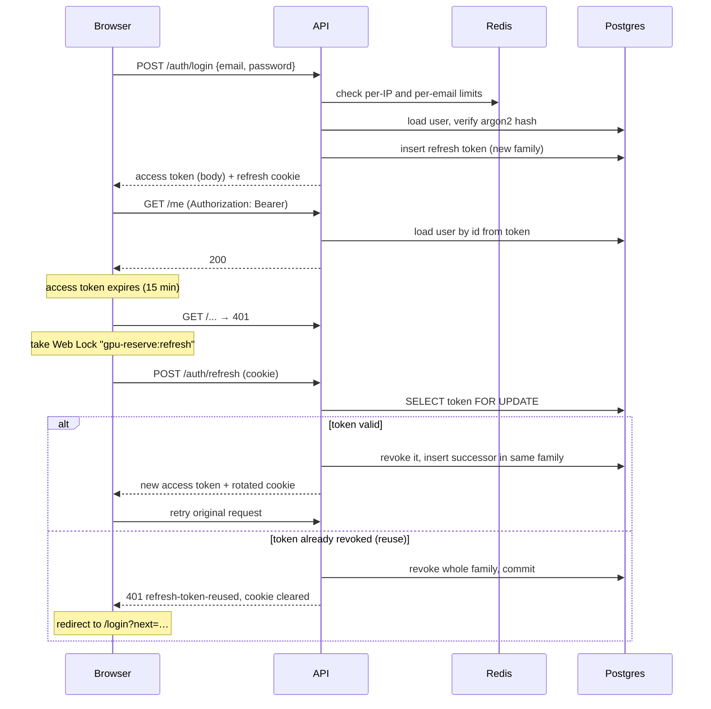

# Architecture

A short overview. It will be expanded as components are built.

## Components

| Component | Technology | Notes |
|---|---|---|
| Frontend | React + TypeScript (Vite), Tailwind, shadcn/ui, TanStack Query | Single-page app; talks to the API under `/api/v1` |
| API | FastAPI (Python 3.12), SQLAlchemy async | Thin routers; business logic in `app/services` |
| Worker | ARQ | Background and scheduled jobs; same image as the API |
| Database | PostgreSQL 16 with `btree_gist` and `pgvector` | Source of truth, including double-booking prevention |
| Cache / queue | Redis 7 | ARQ queue, rate limits, availability cache |
| Email | Mailpit locally | |

## Health

- `GET /api/v1/health` — liveness. The process is up; no I/O.
- `GET /api/v1/ready` — readiness. The database and Redis are reachable; otherwise 503.

## Authentication

Short-lived access tokens are kept in browser memory. Sessions persist through a rotating refresh token in an `HttpOnly` cookie scoped to `/api/v1/auth`. Design reasoning is in [decisions.md](decisions.md#phase-2--auth-and-users).

### Endpoints

| Endpoint | Purpose |
|---|---|
| `POST /api/v1/auth/register` | Create a student account and start a session (201) |
| `POST /api/v1/auth/login` | Start a session |
| `POST /api/v1/auth/refresh` | Rotate the refresh cookie and return a new access token |
| `POST /api/v1/auth/logout` | End the current session (204) |
| `GET`, `PATCH /api/v1/me` | Current user; change the display name |
| `PUT /api/v1/me/password` | Change password; signs out every other session |
| `/api/v1/users` | Admin user management: list, create, read, update, delete |

Session-starting endpoints return `{access_token, token_type, expires_in, user}` and set the `refresh_token` cookie.

### Sign-in, refresh, and reuse detection

### Session invalidation

| Event | Effect |
|---|---|
| Logout | Revokes the cookie's token family |
| Refresh token reuse | Revokes the whole family |
| Password change | Revokes all of the user's families, then starts a new session for the current device |
| Admin deactivates a user or changes their role | Revokes all of that user's families |
| Deactivation | Access tokens stop working on the next request, because every request reloads the user |

### Errors

Every error response is an RFC 7807 problem document (`application/problem+json`) with a stable `type` URI, `title`, `status`, `detail`, and `instance`. Validation errors add `errors: [{field, message}]`. Rate-limited responses (429) include `Retry-After`.
