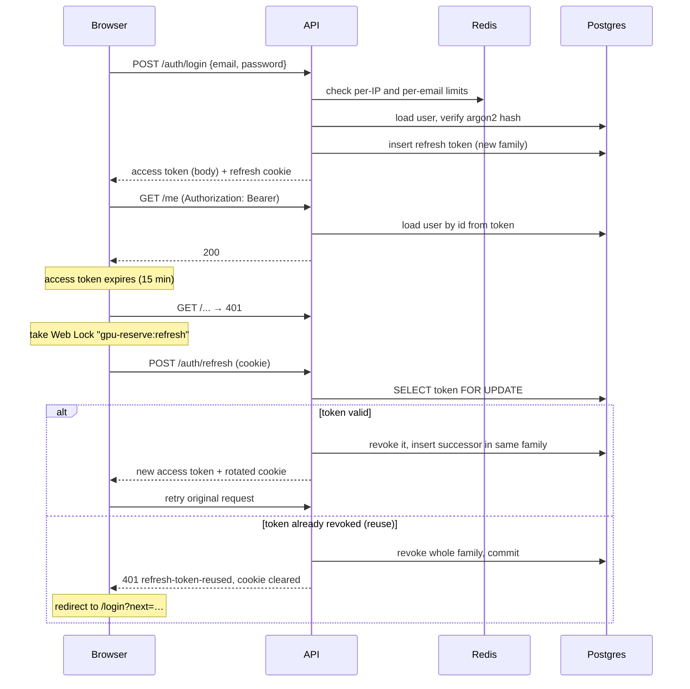
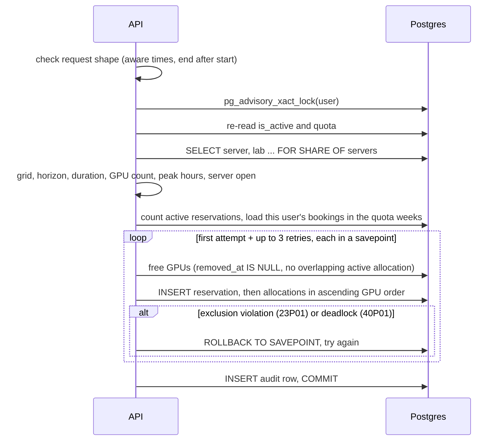
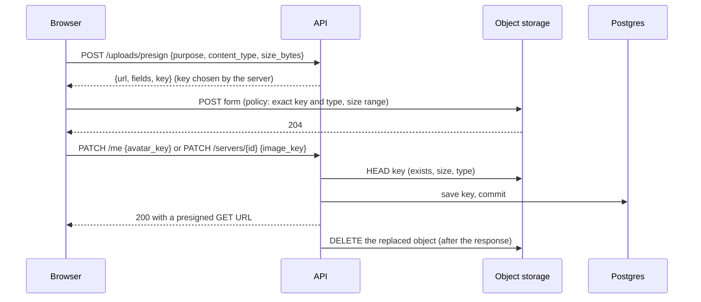
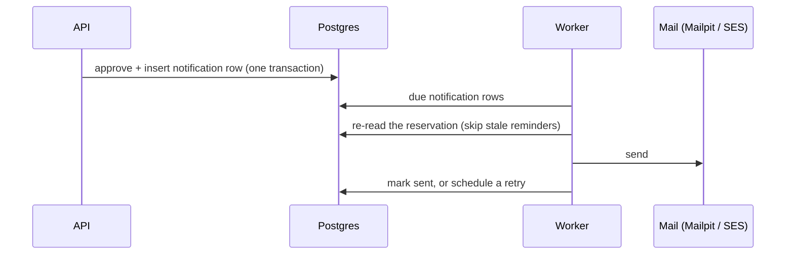

# Architecture

A short overview. It will be expanded as components are built.

## Components

| Component | Technology | Notes |
|---|---|---|
| Frontend | React + TypeScript (Vite), Tailwind, shadcn/ui, TanStack Query | Single-page app; talks to the API under `/api/v1` |
| API | FastAPI (Python 3.12), SQLAlchemy async | Thin routers; business logic in `app/services` |
| Worker | ARQ | Background and scheduled jobs; same image as the API |
| Database | PostgreSQL 16 with `btree_gist` and `pgvector` | Source of truth, including double-booking prevention |
| Cache / queue | Redis 7 | ARQ queue, rate limits, availability cache |
| Object storage | SeaweedFS locally, S3 in production | Avatars and server images; private bucket, presigned URLs |
| Email | Mailpit locally, SES in production | Sent by the worker from a `notifications` outbox table |

## Health

- `GET /api/v1/health` — liveness. The process is up; no I/O.
- `GET /api/v1/ready` — readiness. The database and Redis are reachable; otherwise 503.

## Authentication

Short-lived access tokens are kept in browser memory. Sessions persist through a rotating refresh token in an `HttpOnly` cookie scoped to `/api/v1/auth`. Design reasoning is in [decisions.md](decisions.md#phase-2--auth-and-users).

### Endpoints

| Endpoint | Purpose |
|---|---|
| `POST /api/v1/auth/register` | Create a student account and start a session (201) |
| `POST /api/v1/auth/login` | Start a session |
| `POST /api/v1/auth/refresh` | Rotate the refresh cookie and return a new access token |
| `POST /api/v1/auth/logout` | End the current session (204) |
| `GET`, `PATCH /api/v1/me` | Current user; change the display name or avatar |
| `PUT /api/v1/me/password` | Change password; signs out every other session |
| `/api/v1/users` | Admin user management: list, create, read, update, delete |

Session-starting endpoints return `{access_token, token_type, expires_in, user}` and set the `refresh_token` cookie.

### Sign-in, refresh, and reuse detection

### Session invalidation

| Event | Effect |
|---|---|
| Logout | Revokes the cookie's token family |
| Refresh token reuse | Revokes the whole family |
| Password change | Revokes all of the user's families, then starts a new session for the current device |
| Admin deactivates a user or changes their role | Revokes all of that user's families |
| Deactivation | Access tokens stop working on the next request, because every request reloads the user |

### Errors

Every error response is an RFC 7807 problem document (`application/problem+json`) with a stable `type` URI, `title`, `status`, `detail`, and `instance`. Validation errors add `errors: [{field, message}]`. Rate-limited responses (429) include `Retry-After`.

## Labs and servers

| Endpoint | Purpose |
|---|---|
| `GET /api/v1/labs`, `GET /api/v1/labs/{id}` | List and read labs; students see active labs only |
| `POST`, `PATCH`, `DELETE /api/v1/labs…` | Admin lab management; deleting a lab that still has servers is refused (409) |
| `GET /api/v1/servers`, `GET /api/v1/servers/{id}` | List with filters (`lab_id`, `gpu_model`, `min_gpu_memory_gb`, `min_gpus`, `status`) and read; students don't see retired servers or servers in inactive labs |
| `POST`, `PATCH`, `DELETE /api/v1/servers…` | Admin server management; changing `gpu_count` adds or soft-removes GPU rows |
| `POST /api/v1/uploads/presign` | Signed upload form for an `avatar` (any user) or `server_image` (admins) |

Each server has one GPU row per active GPU, numbered from 0. Reasoning for visibility, GPU numbering, and soft removal is in [decisions.md](decisions.md#phase-3--labs-and-servers).

## Reservations

| Endpoint | Purpose |
|---|---|
| `POST /api/v1/reservations` | Book GPUs on a server; `approved` at once, or `pending` on servers that require approval |
| `GET /api/v1/reservations` | Students see their own; admins see all. Filters: `status`, `server_id`, `user_id` (admins), and `from`/`to` (overlap) |
| `GET /api/v1/reservations/{id}` | Owner or admin |
| `POST /api/v1/reservations/{id}/cancel` | Owner or admin; a running reservation ends early at the next half hour |
| `POST /api/v1/reservations/{id}/approve`, `/reject` | Admin decisions on pending reservations; reject requires a reason |
| `GET /api/v1/servers/{id}/availability` | Free GPUs per 30-minute slot, merged into runs, for up to 14 days |
| `GET /api/v1/me/quota` | GPU-hours used and left in the current quota week, or the week containing `?at=` |
| `GET /api/v1/reservations/{id}.ics` | iCalendar file for one of your own reservations |
| `POST /api/v1/search/slots` | Ranked (server, start, end) candidates for N GPUs for a duration in a window |
| `GET /api/v1/stats/overview` | Dashboard numbers; admins also get queue size and GPU usage |
| `GET /api/v1/stats/utilization` | Admin: booked, pending, and available GPU-hours per server |

Each reservation holds one `gpu_allocations` row per GPU. An exclusion constraint on `(gpu_id, time range) WHERE active` makes double-booking impossible at the database level. Allocation picks the lowest free GPU numbers and retries in a savepoint if another booking takes one first.

### Creating a reservation

### Locks

| Path | Takes, in order |
|---|---|
| Booking | user advisory lock, then server row `FOR SHARE` |
| Server change or delete | server row `FOR UPDATE` |
| Quota change, deactivation | user advisory lock (deactivation then locks the user's reservation rows) |
| Approve, reject, cancel | reservation row `FOR UPDATE` |

Reasoning, alternatives, and the concurrency tests are in [decisions.md](decisions.md#phase-4--reservations).

### Pages

| Page | What it does |
|---|---|
| Server detail (`/servers/:id`) | Seven-day availability timeline in the lab's time zone, and the booking dialog; clicking a free half hour starts a booking there |
| My reservations (`/reservations`) | Weekly quota bar, the signed-in user's reservations with a status filter, and cancel or end early |
| Approvals (`/admin/approvals`) | Admins approve or reject pending requests, soonest start first |

Times are converted between the lab's wall clock and UTC in the browser with `Intl` (`frontend/src/lib/lab-time.ts`). The API only ever sees UTC instants with an offset.

## Uploads

The API never handles image bytes. It signs a form, the browser posts the file to storage, and the API checks the stored object before saving its key.

- The bucket is private. Images are read through presigned GET URLs signed at the start of the current hour, so a URL stays the same for an hour and the browser can cache the image.
- In the browser, the storage POST is a plain `fetch` without the access token or cookies. Saving an upload is a separate form action; an upload that is never saved stays in the bucket (a known gap, see decisions).
- Locally, SeaweedFS runs in the `storage` and `full` Compose profiles. The API reaches it as `seaweedfs:8333` on the Compose network and signs browser URLs for `localhost:8333`.
- Upload forms are limited per user (30 per 10 minutes).

## Background jobs and email

The worker runs the ARQ image with a cron schedule. Each task opens a transaction and calls a function in `app/services/jobs.py` with the current time.

| Job | Every | Does |
|---|---|---|
| `expire_pending` | minute | Pending reservations past their start become `expired`; GPUs released; owner notified |
| `complete_finished` | 5 minutes | Approved reservations past their end become `completed`; GPUs released |
| `queue_reminders` | 5 minutes | Queues a reminder for approved reservations starting within the hour |
| `dispatch_notifications` | minute | Sends due rows from the outbox, with retries and backoff |

- Notifications are written in the same transaction as the change they report, so a committed change always has one and a rolled-back change never does.
- The sweeping jobs are single idempotent statements and take a per-job advisory lock, so overlapping ticks do not run together.

## End-to-end tests

Playwright drives the production build of the frontend (`vite preview`) against `docker-compose.e2e.yml`, a separate Compose project with Postgres in memory, Redis, the API, the worker, and Mailpit. Global setup migrates and empties that database, creates an admin, and adds a lab with two servers. See `frontend/e2e/README.md`.
